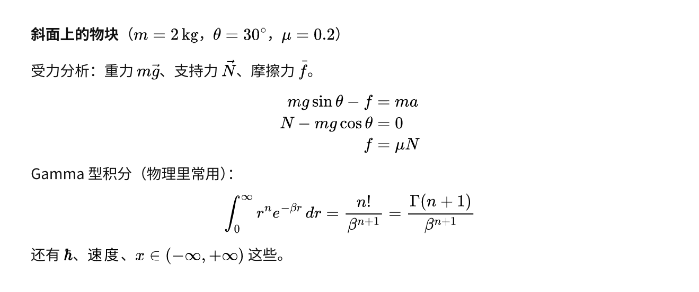

# astrbot_plugin_mathviz

把**整条回答**排成一张白底黑字的长图（公式用 [MathJax](https://www.mathjax.org/) 真排版），
另外提供一组受限的**绘图工具**（函数曲线 / 隐式方程 / 极坐标 / 参数方程 / 几何示意图）。

给 QQ 群里的数学、物理解题用：模型正常写 Markdown + LaTeX，插件自动把整段回答排成一页图片发出去，
不再出现「文字里夹着一堆公式小图、还被切断成好几条消息」。

## 效果



- **公式**：LaTeX 原样交给 MathJax（TeX 引擎），产出自包含 SVG，再嵌进 Typst 页面
- **排版**：Typst 负责段落、列表、标题、中文，一页到底、高度自适应
- **绘图**：`plot_function` / `plot_implicit` / `plot_polar` / `plot_parametric` / `draw_figure`
- **安全**：绘图表达式走 AST 白名单，**不执行任意代码**（不用 `sympify`/`eval` 直通）

## 安装

1. 把本目录放进 AstrBot 的 `data/plugins/`；
2. **依赖**：AstrBot 会自动读 `requirements.txt`（matplotlib / numpy / Pillow / typst / tylax），无需手动装；
3. **中文字体**（必需，否则图里的中文是方框）：

   | 系统 | 做法 |
   |---|---|
   | Debian / Ubuntu | `sudo apt install fonts-noto-cjk` |
   | Windows / macOS | 系统自带，通常无需处理 |

   也可以把任意中文字体路径填进配置项 `font_path`。插件找不到字体时会在日志里打印安装提示。

4. **MathJax**（可选，强烈建议）：需要系统里有 `node` 和 `npm`。**默认不自动安装**，三选一：

   | 方式 | 做法 | 效果 |
   |---|---|---|
   | 手动安装（推荐） | `mkdir -p <数据目录>/plugin_data/astrbot_plugin_mathviz/mathjax && cd $_ && npm i mathjax-full` | 公式覆盖率 ~99% |
   | 自动安装 | 把配置项 `mathjax_auto_install` 设为 `true`，首次整页排版时联网自动执行上面的命令 | 同上 |
   | 不安装 | 什么都不做 | 自动退回内置 Typst 数学引擎：常见写法可用，复杂宏会降级成原文 |

## 配置

| 项 | 默认 | 说明 |
|---|---|---|
| `sheet_mode` | `auto` | `auto`：含公式且正文 ≥ `sheet_min_chars` 才整页；`always`：含公式就整页；`off`：关闭 |
| `sheet_min_chars` | 120 | `auto` 模式的字数门槛 |
| `sheet_width_pt` / `sheet_font_pt` | 480 / 10.5 | 页面宽度与字号（手机上一行约 30 字） |
| `sheet_ppi` / `sheet_max_px` | 200 / 5000 | 出图分辨率与长边上限（超长自动降 PPI） |
| `font_path` | 空 | 中文字体文件；空 = 自动探测 |
| `mathjax_dir` | 空 | MathJax 目录；空 = `<插件数据目录>/mathjax` |
| `mathjax_auto_install` | true | 缺 MathJax 时自动 npm 安装 |
| `dpi` / `line_width` / `show_grid` | 140 / 2.0 / true | 绘图工具的出图参数 |
| `rate_limit_per_minute` | 6 | 每人每分钟最多画几张（QQ 有频控） |
| `timeout_seconds` | 25 | 单次渲染超时 |

## 指令与工具

| 类别 | 内容 |
|---|---|
| 指令 | `/画图 sin(x)`、`/几何 [{"type":"circle","center":[0,0],"r":1}]` |
| 工具 | `plot_function`、`plot_implicit`、`plot_parametric`、`plot_polar`、`draw_figure` |

`draw_figure` 的元素：`point` / `segment` / `arrow` / `circle` / `arc` / `angle` / `polygon` / `text`，
用来画受力图、几何题配图、矢量分解。

## 目录结构

```
.
├── main.py              插件入口：整页排版钩子 + 绘图工具/指令
├── viz/
│   ├── sheet.py         Markdown+LaTeX → Typst 页面（含整条链路）
│   ├── mathjax.py       LaTeX → SVG（node 子进程，可选依赖）
│   ├── tex2svg.js       MathJax 渲染脚本（随插件分发）
│   ├── worker.py        绘图渲染子进程（matplotlib）
│   ├── figure.py        绘图样式与字体
│   └── safeexpr.py      表达式 AST 白名单（不执行任意代码）
├── docs/preview.png     效果图
└── requirements.txt / package.json / metadata.yaml
```

## 许可

**AGPL-3.0**（强传染性）：

- 修改后再分发，必须同样以 AGPL 提供完整源码；
- **通过网络提供服务**（例如部署成机器人给别人用）时，使用者也必须能获取修改后的源码；
- 如需闭源或商业授权，请另行联系作者。
